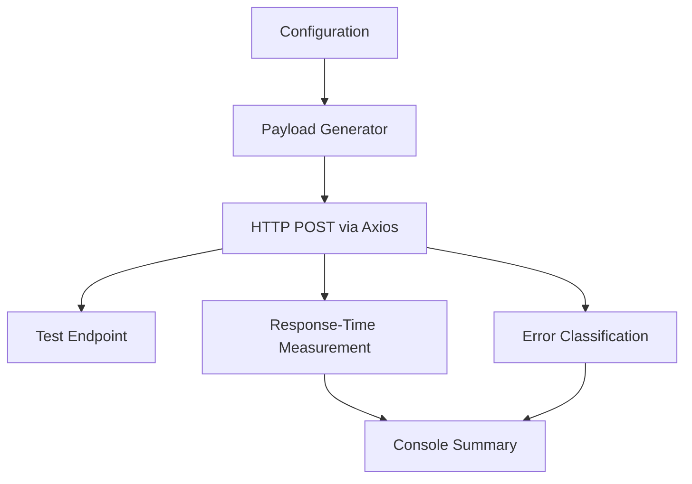

DIG-ONE
Web Resource-Exhaustion Research Tool
A Node.js research prototype for studying web application request handling in controlled, authorized environments.

Project Overview
DIG-ONE is a Node.js proof of concept that explores how web applications process structured JSON requests and larger request bodies. It sends HTTP POST requests to a configured endpoint, measures response times, and reports common HTTP and connection errors.

The project is intended for cybersecurity learning, defensive validation, and authorized testing in an isolated lab. It is not a production load-testing platform.
[!WARNING]
This script can generate a high volume of requests and may affect service availability. Use it only against systems you own or have explicit written authorization to test. Never target public or third-party systems without permission.

Architecture

Key Features
Feature	Description
Nested JSON generation	Creates nested JSON objects for request-parsing experiments.
Large-string generation	Creates a repeated string payload of approximately 50 KB.
HTTP request handling	Sends JSON-formatted POST requests using Axios.
Response-time measurement	Measures elapsed time for individual requests.
Error classification	Reports connection refusal, timeout, HTTP errors, and generic failures.
Run summary	Prints aggregate response and failure counts.

Technology Stack

Technology	Purpose
	JavaScript runtime
	HTTP request client
JavaScript perf_hooks	Request timing
npm	Dependency management

Repository Structure
dig-ddos-tool/
├── package.json
├── package-lock.json
├── server_attack.js
└── README.md
package-lock.json is generated by npm during dependency installation.
Configuration Reference
The current source defines these settings in server_attack.js:
Parameter	Current value	Purpose
TARGET_URL	Placeholder URL	Base URL of the authorized test service
TARGET_ENDPOINT	Placeholder path	Endpoint used by the request
CONCURRENCY_LIMIT	500	Declared concurrency value
TOTAL_REQUESTS	5000	Total requests prepared by the script
PAYLOAD_TYPE	NESTED_JSON	Payload mode: NESTED_JSON or LARGE_STRING
Request timeout	15000 ms	Timeout for an individual request

[!IMPORTANT]
Implementation limitation: CONCURRENCY_LIMIT is currently printed but not enforced. The script prepares promises for all requests before awaiting them, so actual concurrency is not capped by this setting. Review this behavior and the recursive payload generator before any lab execution.

Setup
Prerequisites: Node.js and npm installed on your system.
npm install
Before running anything, review server_attack.js, confirm that the destination is an isolated and authorized test environment, and use conservative test parameters. The current defaults are high-volume and are not appropriate for an initial test.
Example Output
The script prints per-request results and a final summary. Output may include:
[SUCCESS] Request ...: Status ... | Time: ...ms
[FAILURE] Request ...: TIMEOUT_FAIL | Error: ...
Exact output depends on the endpoint and network conditions. Client-side errors alone do not prove a server-side outage; validate findings using authorized server-side metrics and logs.
Limitations
- The configured concurrency value is not currently enforced.
- Creating all request promises at once may consume substantial local memory and resources.
- Target settings are placeholders and should refer only to an authorized lab endpoint.
- A timeout or failed request does not by itself identify the cause of a server-side issue.
- This is a research prototype, not a production-grade performance-testing framework.
Responsible Use
- Test only systems you own or are explicitly authorized to assess.
- Define the permitted scope, time window, and request budget before testing.
- Prefer a disposable local lab or isolated staging environment.
- Monitor CPU, memory, latency, and server logs; stop if instability occurs.
- Do not use this tool to disrupt, overwhelm, or degrade services.
License
No license is currently specified. Add a license before allowing reuse or redistribution.

DIG-ONE · Cybersecurity Research · Authorized Testing Only

