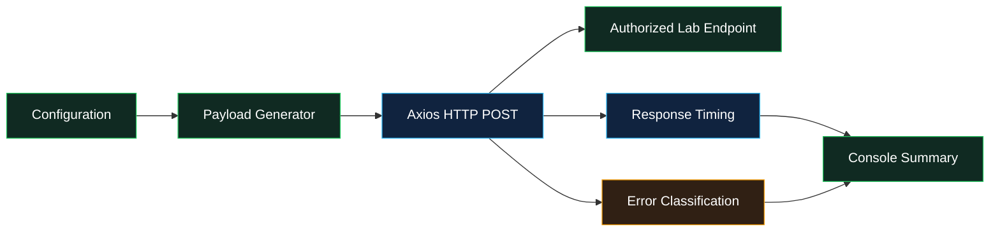

DIG-ONE
Web Security Research Prototype
A Node.js project for exploring HTTP request handling in controlled, authorized lab environments.

<!--
GRAPHIC HEADER:
Add a banner image to your repository at assets/dig-one-banner.png, then uncomment:

  

-->

Overview
DIG-ONE is a Node.js proof of concept for studying how web applications handle structured JSON requests and larger request bodies. It uses Axios to send HTTP POST requests to a configured endpoint, measures response time, and reports common HTTP and connection errors.

This repository is intended for cybersecurity learning, defensive validation, and authorized testing in an isolated lab. It is a research prototype—not a production-grade load-testing framework.
[!WARNING]
The current script is configured with high request-volume values and can affect service availability. Use it only against systems you own or have explicit written authorization to test. Never target public or third-party services without permission.

Visual Architecture

Features
Feature	Description
Nested JSON generation	Creates nested objects for request-parsing experiments.
Large-string generation	Creates a repeated string payload of approximately 50 KB.
HTTP request handling	Sends JSON-formatted POST requests using Axios.
Response-time measurement	Measures elapsed time for individual requests.
Error classification	Reports connection refusal, timeout, HTTP errors, and generic failures.
Summary reporting	Prints aggregate response and failure counts.

Technology Stack

Technology	Role
	JavaScript runtime
	HTTP client
	Application logic
perf_hooks	Request timing
npm	Dependency management

Repository Structure
dig-ddos-tool/
├── package.json
├── package-lock.json
├── server_attack.js
├── assets/
│   └── dig-one-banner.png   # Optional README banner graphic
└── README.md
package-lock.json is generated by npm when dependencies are installed. The banner image is optional; the architecture diagram above is rendered by GitHub through Mermaid.
Configuration Reference
The current source defines the following settings in server_attack.js:
Parameter	Current value	Purpose
TARGET_URL	Placeholder URL	Base URL for the authorized lab service
TARGET_ENDPOINT	Placeholder path	Endpoint used for requests
CONCURRENCY_LIMIT	500	Declared concurrency value
TOTAL_REQUESTS	5000	Number of requests prepared by the script
PAYLOAD_TYPE	NESTED_JSON	Selects NESTED_JSON or LARGE_STRING
Request timeout	15000 ms	Per-request timeout

[!IMPORTANT]
Implementation limitation: CONCURRENCY_LIMIT is currently printed but not enforced. The script prepares promises for all requests before awaiting them, so this setting does not cap actual concurrency. The recursive payload generator and resource usage should be reviewed before any lab execution.

Setup
Prerequisites: Node.js and npm.
npm install
Before executing the script, review the source, confirm the destination is an isolated and authorized test environment, and use conservative test parameters. The current defaults are high-volume and are not suitable for an initial test.
Output
The script prints per-request outcomes and a final summary. Example log formats:
[SUCCESS] Request ...: Status ... | Time: ...ms
[FAILURE] Request ...: TIMEOUT_FAIL | Error: ...
Exact output depends on the endpoint and network conditions. Client-side errors alone do not prove a server-side outage; validate any findings with authorized server-side monitoring and logs.
Limitations
- The configured concurrency value is not currently enforced.
- Preparing all request promises at once may consume substantial local memory and resources.
- Target settings are placeholders and should refer only to an authorized lab endpoint.
- A timeout or failed request does not, by itself, identify the cause of a server-side issue.
- This is a research prototype, not a production-grade performance-testing framework.
Responsible Use
- Test only systems you own or are explicitly authorized to assess.
- Define the permitted scope, time window, and request budget before testing.
- Prefer a disposable local lab or isolated staging environment.
- Monitor CPU, memory, latency, and server logs; stop if instability occurs.
- Do not use this project to disrupt, overwhelm, or degrade services.
License
No license is specified yet. Add a license before permitting reuse or redistribution.

DIG-ONE · Web Security Research · Authorized Testing Only

